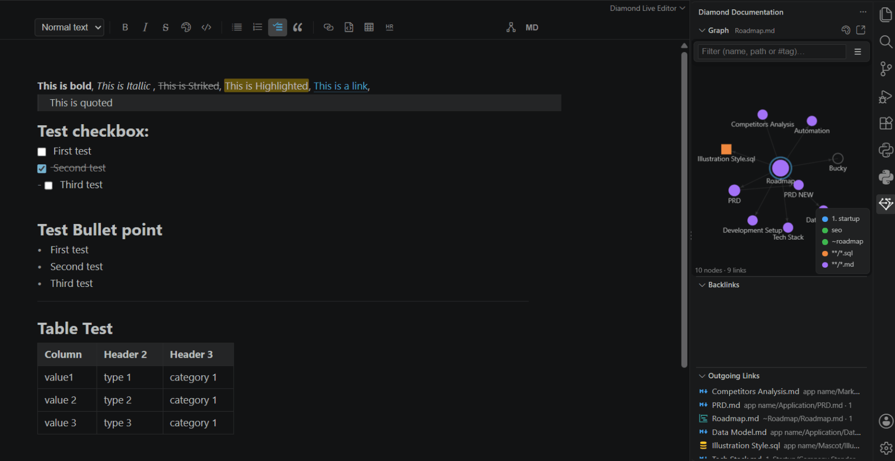

<p align="center"></p>

# Diamond Documentation

Write and navigate project documentation inside VS Code. Notes are plain Markdown files that live next to your code, so Git versions them like everything else, and they can link to **any** file in the project:  `.md` files, `.sql` scripts, `.ts` sources, `.html` pages, images, binaries, etc.



## Features

| Area | What you get |
| --- | --- |
| Live editor | Markdown files open in an editable, formatted view by default, with a formatting toolbar: headings, bold, italic, highlights, tags, links, checkboxes, bullets, quotes, tables, code blocks, rules and images are shown rendered. Images can be Markdown (<code>![alt]&#40;path)</code>, sized with <code>![alt&#124;300]&#40;path)</code>), embeds (`![[diagram.png]]`), HTML `` tags (including `<p align="center">`), linked badges or table cells. The raw Markdown appears only on the lines you are editing. |
| Formatting | Toggle bold, italic, strikethrough, `==highlight==` and inline code; code blocks with a language picker; bullet, numbered and checkbox lists; heading cycle; blockquote; table insert and table auto-align. The same shortcuts work in the live editor and in the source editor. |
| Links | `[[note]]`, `[[note#Heading]]`, `[[note#^block-id]]`, `[[note\|alias]]`, `[[folder/note]]`, `[[schema.sql]]`, `[[src/api.ts]]`, `![[diagram.png]]`, and normal <code>[text]&#40;path)</code> links |
| Navigation | Click a link in the live editor (Ctrl/Cmd+Click while editing that line), or Ctrl+Click / F12 in the source editor. Hover a link to preview its target. Clicking a link to a note that does not exist yet offers to create it. |
| Autocomplete | Type `[[` to list every file in the project; type `[[note#` to list that note's headings |
| Renames | Renaming or moving a file **or folder** rewrites every link to it (and the relative links inside moved notes) and saves the files, without asking |
| Status bar | Word count, character count, backlinks and outgoing links for the current note, next to Ln/Col. A selection shows its own counts. Click the link counts to open the matching panel. |
| Side bar | A **Diamond** icon in the activity bar shows a live local graph of the file you have open (its outgoing links and backlinks, with arrows showing direction), updating as you switch files, plus Backlinks and Outgoing Links panels. Untick **Local** in its ☰ filters for the whole graph. |
| Graph | Local graph of the open file (on by default, depth 1–5) or the whole project, filter by name, path or `#tag`, toggle **Docs** (circles) and **Files** (squares), unresolved links, orphans, labels and the colour **Legend** (off by default). **Fit** zooms to show everything. Click a node to open it, Ctrl/Cmd+Click to open it beside. |
| Colours | Colour graph nodes by folder or file pattern with `.diamond/graph.yml` |
| Preview | VS Code's built-in Markdown preview also renders links, embeds, highlights and task checkboxes |

## Live editor

Markdown files open in the live editor automatically. To see the raw Markdown, click **MD** on the toolbar, the `</>` icon in the title bar, or press **Ctrl+Shift+V**; the file switches in place and stays in source view until you close that tab. Press **Ctrl+Shift+V** again (or the eye icon) to go back. Git diffs always use the normal text diff.

The toolbar has a text-style picker (normal text, headings 1–6), bold, italic, strikethrough, highlight, inline code, bullet / numbered / checkbox lists, quote, link to a file, code block, table, divider, local graph and the source switch. Buttons light up for the formatting under the cursor.

The live editor edits the same file as the source editor: saving, unsaved-changes markers, Git and undo all keep working, and both views stay in sync if you open them side by side.

To open Markdown in the source editor by default instead, turn off `diamond.liveEditor.openByDefault` (or run **Diamond: Toggle Opening Markdown in the Live Editor**).

## Graph colours

Run **Diamond: Configure Graph Colours** (or click the colour icon on the Graph view). It creates `.diamond/graph.yml` pre-filled with your top-level folders:

```yaml
folders:                      # every note and file inside the folder, sub-folders included
  docs: "#4f9dff"
  docs/architecture: "#a371f7"   # the deepest matching folder wins
  src: "#f0883e"
  database: "#3fb950"

patterns:                     # glob patterns win over folders
  "**/*.sql": "#3fb950"

defaults:                     # anything not matched above
  documentation: "#9da5b4"
  files: "#d29922"
  unresolved: "#6e7681"
```

Any CSS colour works (`"#hex"`, `"rgb(…)"`, `"teal"`). A `.diamond/graph.json` with the same shape is also accepted. Changes apply as soon as you save. Tick **Legend** in the graph's filters to show which colour is which. Commit the `.diamond` folder so your team shares the same colours.

## Shortcuts

These shortcuts apply in Markdown files and in the live editor.

| Action | Windows / Linux | macOS |
| --- | --- | --- |
| Bold | Ctrl+B | Cmd+B |
| Italic | Ctrl+I | Cmd+I |
| Strikethrough | Ctrl+Shift+X | Cmd+Shift+X |
| Highlight | Ctrl+Shift+H | Cmd+Shift+H |
| Inline code | Ctrl+E | Cmd+E |
| Code block | Ctrl+Shift+K | Cmd+Shift+K |
| Toggle checkbox | Ctrl+L | Cmd+L |
| Bullet list | Ctrl+Shift+8 | Cmd+Shift+8 |
| Numbered list | Ctrl+Shift+7 | Cmd+Shift+7 |
| Cycle heading | Ctrl+Shift+] | Cmd+Shift+] |
| Insert link to file | Ctrl+Alt+L | Cmd+Alt+L |
| Live editor ⇄ source | Ctrl+Shift+V | Cmd+Shift+V |
| Graph view | Ctrl+Alt+G | Cmd+Alt+G |

Table insert, table format and blockquote are in the Command Palette under **Diamond:**. Any shortcut can be changed in *Keyboard Shortcuts*.

## Settings

| Setting | Default | |
| --- | --- | --- |
| `diamond.updateLinksOnRename` | `true` | Rewrite links when files or folders move, then save. Files that already had unsaved changes are updated but left unsaved. |
| `diamond.liveEditor.openByDefault` | `true` | Open Markdown in the live editor |
| `diamond.liveEditor.toolbar` | `true` | Show the formatting toolbar |
| `diamond.statusBar.enabled` | `true` | Show word / character / link counts in the status bar |
| `diamond.exclude` | `**/{node_modules,.git}/**` | Files that cannot be linked and are not indexed |
| `diamond.newNoteFolder` | *(empty)* | Where notes created from unresolved links go (empty = next to the current note) |
| `diamond.graph.showFiles` / `showOrphans` | `true` | Default graph filters |
| `diamond.liveEditor.readableLineLength` / `fontSize` / `fontFamily` | | Live editor appearance |
| `diamond.listContinuation` | `true` | Enter continues lists in the source editor |


### Layout

- `src/extension.ts`: activation and wiring
- `src/parser.ts`: link, heading and tag parser
- `src/linkIndex.ts`: workspace file index, link resolution, backlinks, graph data
- `src/linkFeatures.ts`: clickable links, completion, hover, go-to-definition, create-on-click
- `src/renameLinks.ts`: link rewriting on rename / move
- `src/liveEditor.ts` + `src/webview/`: the live editor (a custom text editor built on CodeMirror 6)
- `src/shared/format.ts`: formatting operations shared by both editors
- `src/shared/colors.ts` + `src/colorConfig.ts`: `.diamond/graph.yml`
- `src/graphView.ts` + `media/graph.js`: graph panel and side bar view (canvas, Barnes–Hut force layout)
- `src/linkViews.ts`: Backlinks and Outgoing Links views
- `src/statusBar.ts` + `src/shared/stats.ts`: status bar counts
- `src/openDefault.ts`: opening Markdown in the live editor, switching to source in place
- `src/webview/toolbar.ts`: live editor toolbar
- `src/preview.ts`: markdown-it plugin for the built-in preview
